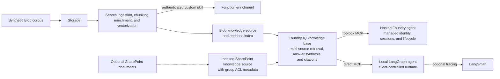

# Microsoft Foundry IQ Knowledge Retrieval Quickstart

Deploy a disposable Foundry IQ knowledge environment backed by Azure AI Search
for evaluating grounded, cited dispute-support answers from synthetic content
across hosted and local agent runtimes.

## Use case

This is a [Microsoft Foundry IQ](https://learn.microsoft.com/azure/foundry/agents/concepts/what-is-foundry-iq)
demo. Foundry IQ is the managed knowledge layer in this architecture. The demo
turns each configured data source into an Azure AI Search knowledge source,
attaches those sources to one Foundry IQ knowledge base, and exposes grounded
answers and citations to either a Hosted Foundry agent or a Local agent. The
default deployment uses the synthetic Blob corpus; the optional SharePoint
source joins the same knowledge base.

The central value is reuse: content is ingested and governed once in the
knowledge layer, while different agent runtimes consume the same retrieval
contract. Use Microsoft Foundry for managed hosted-agent connectivity and
lifecycle capabilities. Use the Local agent or direct Search access when you
want to control the client runtime. The optional
[SharePoint path](./docs/sharepoint-permission-trimming.md) adds group-based
document permission trimming to both agents; the default Blob quickstart does
not deploy it.

## Why Foundry IQ matters in this demo

| Foundry IQ value | What this repository demonstrates |
|---|---|
| Reusable enterprise knowledge layer | One Search-backed knowledge base serves both the Hosted Foundry agent and the Local LangGraph agent, so retrieval logic and source onboarding are not rebuilt per agent. |
| Agentic retrieval for complex questions | The knowledge base can break a request into focused subqueries, retrieve in parallel, rerank the combined results, and synthesize a concise answer. |
| Grounded, explainable answers | Answer synthesis returns references that the agents surface as citations instead of answering from model memory alone. |
| Multi-source knowledge composition | The default Blob knowledge source and optional indexed SharePoint knowledge source can fan into the same knowledge base and contribute to one answer. |
| Security-aware retrieval | The optional SharePoint path ingests group ACL metadata and carries the calling user's Search token through either agent path so Search can trim documents before they reach the model. |
| Runtime choice without retrieval drift | The Hosted agent reaches the knowledge base through a Foundry Toolbox MCP connection; the Local agent calls the same knowledge-base MCP endpoint directly. |
| Managed and direct operating models | The demo separates Foundry-hosted identity, sessions, tracing, and lifecycle from the underlying Search retrieval plane, while preserving a direct-access option for applications that own those concerns. |

The root quickstart proves the default Blob ingestion and knowledge-base
retrieval path. SharePoint, permission trimming, the Hosted agent, and the
Local agent are separately configured extensions, with their own setup and
validation steps.

## What gets deployed

| Area | Quickstart deployment |
|---|---|
| Azure AI Search / Foundry IQ | Search service, Blob ingestion, skillset, vector index, Blob knowledge source, and shared Foundry IQ knowledge base |
| Microsoft Foundry | Foundry account and project, connection to the Search-backed Foundry IQ knowledge layer, chat model deployment, and `text-embedding-3-large` deployment |
| Storage | One private-only account with separate containers for the synthetic corpus and Function package, four private endpoints, and private DNS |
| Custom skill | Linux Function on Elastic Premium with regional VNet integration for deterministic synthetic-document enrichment |
| Monitoring | Log Analytics, Application Insights, and diagnostic settings |
| Identity and access | Managed identities and deterministic RBAC assignments for deployment, ingestion, model use, and retrieval |

Storage traffic is private and keyless. Search, Foundry, and Function inbound
endpoints remain public so both agent examples and the Search custom skill can
be tested without a VPN; they require Entra authentication and RBAC. This is
still an evaluation posture rather than a production security baseline.
Search knowledge-base capabilities, APIs, model versions, quotas, and regional
availability include preview-sensitive dependencies and must be revalidated
before deployment.

## Architecture



Both agents query the same Foundry IQ knowledge base. Adding SharePoint extends
that knowledge base with another Search knowledge source; it does not create a
separate agent-specific retrieval path. This is the architectural point of the
demo: knowledge-source integration, retrieval behavior, citations, and
permission enforcement stay in the shared knowledge layer while agent hosting
can vary.

Bicep defines the Azure resources, RBAC, API profiles, and data-plane payloads. The supported PowerShell wrappers validate ownership, invoke Bicep, transport Bicep-emitted operations, upload the synthetic artifacts, and verify the result. The root Bicep/PowerShell quickstart provisions the Search and Foundry knowledge environment but does not publish agent code. After that environment exists, `langgraph-agent-hosted-foundry/` is configured for a separate azd hosted-agent code deployment through its `azure.yaml` and `agent.yaml`; `langgraph-agent-local/` runs separately.

## Deploy in six steps (four commands)

Run every command from the repository root. The guarded wrapper is the only supported public deployment path. Bicep remains authoritative, while the wrapper enforces ownership, contract, private upload, shared-private-link approval, and verification safeguards.

1. **Install and confirm prerequisites.** Follow [Prepare](./docs/quickstart.md#1-prepare): PowerShell 7.4+, Azure CLI with Bicep support, Git, an Azure sign-in, required permissions, and service/model availability.

2. **Choose and confirm required values.** You need the exact subscription ID and location, a lowercase environment name, a stable new deployment GUID, the human operator's Microsoft Entra object ID, a pre-created single-tenant Function API app registration and its `api://<client-id>` audience, and validated chat and embedding model versions. Review all inputs in [Understand inputs and ownership](./docs/quickstart.md#2-understand-inputs-and-ownership). The emitted non-secret contract uses schema `3.1.0`.

3. **Run What-If.**

   ```powershell
   pwsh -NoProfile -File .\scripts\quickstart\deploy.ps1 `
     -SubscriptionId '<confirmed-subscription-id>' `
     -Location '<confirmed-location>' `
     -Environment 'foundry-quickstart' `
     -DeploymentId '<stable-deployment-id>' `
     -OperatorPrincipalId '<operator-object-id>' `
     -FunctionAuthClientId '<function-api-app-client-id>' `
     -FunctionAuthAudience 'api://<function-api-app-client-id>' `
     -ChatModelVersion '<validated-version>' `
     -EmbeddingModelVersion '<validated-version>' `
     -WhatIf
   ```

   What-If reads Azure context and resource-group state and invokes ARM what-if, then exits before deployment, uploads, or data-plane writes.

4. **Deploy only after reviewing What-If and obtaining authorization.** Run the same command with only `-WhatIf` removed:

   ```powershell
   pwsh -NoProfile -File .\scripts\quickstart\deploy.ps1 `
     -SubscriptionId '<confirmed-subscription-id>' `
     -Location '<confirmed-location>' `
     -Environment 'foundry-quickstart' `
     -DeploymentId '<stable-deployment-id>' `
     -OperatorPrincipalId '<operator-object-id>' `
     -FunctionAuthClientId '<function-api-app-client-id>' `
     -FunctionAuthAudience 'api://<function-api-app-client-id>' `
     -ChatModelVersion '<validated-version>' `
     -EmbeddingModelVersion '<validated-version>'
   ```

5. **Verify the bound deployment.**

   ```powershell
   pwsh -NoProfile -File .\scripts\quickstart\verify.ps1 `
     -ContractPath '.\.azure\quickstart-contract-<deployment-id>.json'
   ```

   Verification checks ownership, resources, security settings, RBAC, data-plane drift, indexing, retrieval, citations, and source identifiers; it does not repair state.

6. **Clean up with exact ownership confirmation.**

   ```powershell
   pwsh -NoProfile -File .\scripts\quickstart\cleanup.ps1 `
     -ContractPath '.\.azure\quickstart-contract-<deployment-id>.json' `
     -SubscriptionId '<confirmed-subscription-id>' `
     -ConfirmResourceGroupName '<exact-owned-resource-group>' `
     -ConfirmDeletion
   ```

   Cleanup permanently deletes the complete positively owned resource group. Review the full deletion scope and obtain immediate explicit confirmation before running it; there is no force bypass or per-resource cleanup.

## Try the agents

- [Deploy the Hosted Foundry agent](./langgraph-agent-hosted-foundry/README.md)
  after the root knowledge environment exists. The guide derives the public
  Toolbox bridge and existing-project azd settings from the quickstart
  contract, then uses direct `azd deploy` code deployment without Docker or
  ACR.
- [Run the Local LangGraph agent in WSL](./langgraph-agent-local/README.md) to
  create a Python 3.12 virtual environment, configure direct knowledge-base
  access from the quickstart contract, and run the foreground CLI with optional
  LangSmith tracing.

Both examples require their own runtime configuration after the knowledge environment exists. Do not treat either folder as part of the six-step infrastructure deployment.

To add permission-aware SharePoint content, complete the separate
[SharePoint group-based document permission trimming](./docs/sharepoint-permission-trimming.md)
guide after the default knowledge environment is verified.

## Project status and boundaries

- **Gate A only:** this revision has passed static/offline validation, not Azure subscription validation, Azure what-if, live deployment, cost measurement, penetration testing, or production certification.
- **Synthetic data only:** use only the included fictional Markdown corpus; do not upload customer, member, employee, transaction, account, case, legal, regulated, confidential, or personal data.
- **Revalidate before use:** preview APIs, model versions, quota, regional support, diagnostic categories, and service behavior can change.
- **Not production-certified:** Search, Foundry, and Function inbound endpoints remain public, and the default Blob topology lacks permission metadata. Private Storage reduces exposure but does not make this a production baseline.

## Repository layout

| Path | Purpose |
|---|---|
| [`infra/`](./infra/) | Bicep source of truth |
| [`scripts/quickstart/`](./scripts/quickstart/) | Supported deploy, verify, and cleanup wrappers |
| [`custom-skill/`](./custom-skill/) | Deterministic enrichment Function |
| [`sample-data/`](./sample-data/) | Synthetic corpus and offline evaluation queries |
| [`langgraph-agent-hosted-foundry/`](./langgraph-agent-hosted-foundry/) | Hosted Foundry agent example |
| [`langgraph-agent-local/`](./langgraph-agent-local/) | Local/direct agent example |
| [`docs/`](./docs/) | Operator and design documentation |

[Operator quickstart](./docs/quickstart.md) · [Architecture](./docs/architecture.md) · [Troubleshooting](./docs/operations/troubleshooting.md) · [Responsible AI](./docs/responsible-ai.md) · [Security](./SECURITY.md) · [Support](./SUPPORT.md) · [Contributing](./CONTRIBUTING.md)
