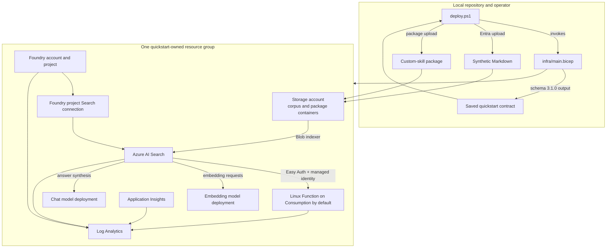

# Architecture

## Operating model

The quickstart creates one new, disposable Azure resource group. Bicep defines
the desired state. The public PowerShell wrapper validates ownership, invokes
Bicep, uploads repository-owned artifacts, transports only Bicep-emitted
data-plane operations, and verifies the result.

The public scenario uses three synthetic Markdown documents about fictional
dispute drills. It does not connect to SharePoint, read tenant content, create
Entra applications, or adopt existing Azure resources.

## Topology

Storage public access is disabled. The quickstart creates private endpoints and
private DNS for Blob, Queue, Table, and File; Search uses a shared private link
for Blob ingestion; the Function uses regional VNet integration; and a
short-lived ACI in a delegated subnet performs package and corpus uploads.
Search, Foundry, and Function inbound endpoints remain public and protected by
Entra authentication and RBAC. This is a development topology, not a complete
production private-network design.

## Provisioned inventory

The subscription-scope entrypoint creates:

- one resource group;
- one Azure AI Search service;
- one Foundry account and project;
- one chat model deployment and one embedding model deployment;
- one project-scoped Search connection;
- one storage account with separate synthetic-corpus and Function-package
  containers;
- one VNet with dedicated Function integration, private endpoint, and upload
  subnets;
- four Storage private endpoints and linked private DNS zones;
- one Search-to-Storage Blob shared private link;
- one upload managed identity used by short-lived ACI jobs;
- one Linux Function app and one Elastic Premium plan;
- one Log Analytics workspace and one Application Insights resource;
- diagnostic settings, managed identities, and deterministic role assignments.

The quickstart does not deploy the repository's agent examples or an
application/API layer.

## Ingestion and retrieval flow

1. The wrapper packages only `*.md` files from the public sample document
   directory and passes them to a short-lived, managed-identity ACI uploader
   inside the VNet.
2. The Search indexer reads Blob content by managed identity.
3. The skillset splits source text, invokes the authenticated custom skill for
   deterministic classification, and creates embeddings.
4. Index projections write chunks and metadata to `policy-chunks-v2`.
5. Bicep-authored operations define the Search knowledge source and knowledge
   base.
6. A retrieval request selects and ranks source material, synthesizes an answer,
   and returns references with source identifiers.

The included corpus has no per-user access-control fields. Azure AI Search can
apply permission-aware filtering when a solution indexes permission data and
configures filters, but that production pattern is not implemented here.

## Responsibility boundary

Azure AI Search owns ingestion and retrieval behavior: source selection,
ranking/reranking, result merging, answer synthesis, citations, and configured
permission filtering. Foundry provides managed agent connectivity, identity
integration, evaluation, monitoring, governance, and lifecycle capabilities.
Direct Search is sufficient when that managed lifecycle is unnecessary.

See [Search and Foundry IQ](./concepts/search-and-foundry-iq.md) for the detailed
boundary.

## Identity and access

| Principal | Access used by the quickstart |
|---|---|
| Deployer/operator | Subscription deployment, role-assignment creation, Search bootstrap, and approval of the uniquely identified Search shared-private-link request |
| Upload managed identity | Blob/package upload from a short-lived ACI inside the VNet |
| Search managed identity | Blob corpus read, Foundry model use, and authenticated custom-skill invocation |
| Foundry project managed identity | Search index data read |
| Function managed identity | Function runtime and package storage access |

The operator object ID is an explicit input. The wrapper does not infer it from
an account alias. No application secret, account key, or SAS token is part of
the deployment contract.

## Bicep-to-PowerShell contract

[`../infra/main.bicep`](../infra/main.bicep) emits `quickstartContract` schema
`3.1.0` with:

- deployment identity, resource-group identity, provenance, and ownership tags;
- resource names, IDs, endpoints, and managed-identity principal IDs;
- six ordered Bicep-authored Search data-plane operations;
- four read-only verification checks, including a semantically read-only
  retrieval request;
- exact cleanup ownership evidence.

PowerShell validates exact properties, hosts, paths, methods, API versions,
operation ordering, retry bounds, and ownership before transport. It does not
carry a second copy of Search or Foundry IQ provisioning payloads.

## Failure and lifecycle boundaries

- First deployment requires the deterministic resource-group name not to exist.
- A rerun requires the saved local contract, canonical subscription deployment
  output, and current ownership/protection tags to agree.
- Verification reports drift but does not repair it.
- A failed deployment leaves the owned resource group intact for inspection,
  same-contract rerun, or guarded cleanup.
- Cleanup deletes only the complete positively owned resource group.

For the complete prepare, what-if, deploy, verify, and cleanup sequence, see the
[operator quickstart](./quickstart.md).
